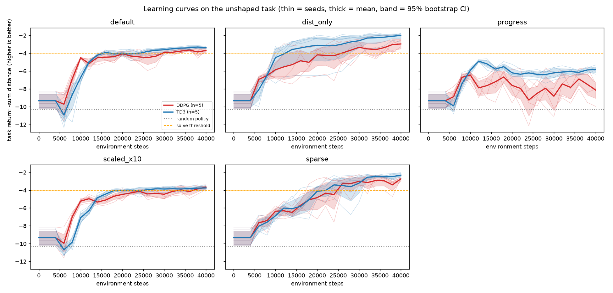
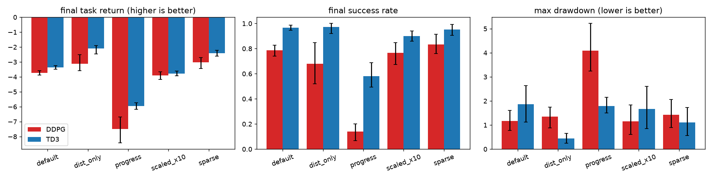
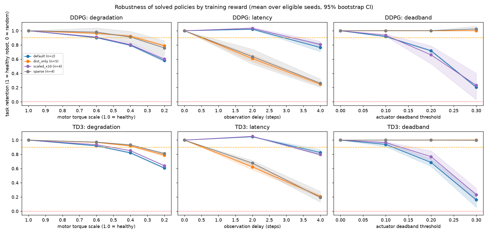

# Deep Feedback Control

A TD3 policy learns to drive a 2-joint MuJoCo arm (`Reacher`) to a random target, and an **IPQC-style (in-process quality control) stress-testing harness** then breaks it on purpose: delayed sensors, sticky actuators and worn motors. The result is a measured *safety boundary* for each failure mode.

The IPQC idea comes from my work at Biobot, where I worked on a similar process. This repository is independent of that work: it runs only on simulated MuJoCo environments and contains no Biobot data or code.

A second part compares **DDPG and TD3 across five training-reward variants** (50 runs) and stress-tests the resulting policies, to see how the training reward changes learning stability and robustness.

The IPQC part trains on one laptop GPU (RTX 3070 Ti, 8 GB); the reward-shaping sweep ran on the CPU (8 parallel processes), because these tiny networks gain nothing from the GPU. Everything is available as scripts and as three Jupyter notebooks that call the same code.

## Results

Trained for 150k steps (about 37 minutes wall-clock on the RTX 3070 Ti). Deterministic evaluation over 60 episodes (3 seeds x 20) per condition. Reacher's reward is `-distance to target` plus `-(action)^2` (control cost); both parts are reported:

| Policy | Total return | Task part (-distance) | Control-cost part |
|---|---|---|---|
| Random actions | -43.35 | -9.78 | -33.57 |
| **Trained TD3, no stress** | **-3.82** (std 1.56) | **-3.11** | -0.72 |


The training curve is recorded with exploration noise on every action, while the evaluation is deterministic, so the curve sits lower and is noisier than the evaluation score.

The figures in this section come from 60 evaluation episodes per condition; notebook 01 prints a quick 20-episode check (-3.84 for the trained policy, -43.48 for random), which differs slightly because it uses fewer episodes.

The sweep below uses its own 100-episode random baseline (task return -10.32, against -9.78 here), so the two random-policy task returns differ slightly.

### Safety boundaries

Each stress level gets a **retention score** on the *task* measure: `(R - R_random) / (R_nominal - R_random)`, where `R` is the summed negative distance to the target. 1.0 means as good as the healthy robot, 0.0 means no better than random at reaching the target, and negative means worse than random. The **safety boundary** is the most severe level reached before the score first drops below 0.9.

| Failure mode | What it simulates | Safety boundary | Retention at the edge |
|---|---|---|---|
| Observation latency | slow or delayed sensors | **safe up to 3 steps**, fails at 4 | 0.981 at 3 steps, 0.778 at 4 |
| Actuator deadband | static friction: commands below a threshold do nothing | **safe up to 0.1**, fails at 0.2 | 0.922 at 0.1, 0.675 at 0.2 |
| Motor degradation | delivered torque is a fraction of the command | **safe down to 60% torque**, fails at 40% | 0.911 at 60%, 0.807 at 40% |

What the measurements show:
- **Latency:** the arm still reaches the target through 3 steps of delay (0.981), but its control effort rises sharply: the control-cost part goes from -0.72 (no delay) to -3.12 at 3 steps and -7.57 at 4. Past 3 steps reaching degrades (0.778 at 4, 0.553 at 5).
- **Deadband:** retention falls steadily. A threshold of 0.05 costs little (0.984), but 0.2 already drops it to 0.675, and at 0.5 the arm is worse than a random policy at reaching the target (-0.201).
- **Degradation:** graceful. 0.911 at 60% torque, 0.595 even at 20%.
- Levels are in different units for each stress, so the boundaries are not a ranking of which failure is "worse".

| Latency | Deadband | Degradation |
|---|---|---|
|  |  |  |

The full table, including total-return scores and mean control cost for every level, is in [`plots/ipqc_results.csv`](plots/ipqc_results.csv).

### Why the score ignores control cost

An earlier version of this analysis scored the full reward and concluded the policy was far more robust than it is. The control-cost term is charged on the action the motors actually receive, so deadband and degradation *reduce* it, and a random policy's deficit is 77% control cost. Scoring total return flatters those stresses badly:

| Condition | Retention on total return | Retention on task (used here) |
|---|---|---|
| Deadband 0.3 | 0.895 | 0.302 |
| Deadband 0.5 | 0.815 | **-0.201** (worse than random) |
| Degradation 20% torque | 0.947 | 0.595 |

Both scores are kept in the CSV (`total_score` and `score`); the boundaries use `score`.

## Reward shaping and learning stability: TD3 vs DDPG

Does the reward a policy *trains on* change how stably it learns, and how it copes with failures? I trained **TD3 and DDPG with identical hyperparameters** (learning rate 1e-3, batch 256, noise sigma 0.1) on five reward variants, 5 seeds each, 40,000 steps per run: **50 runs** on 8 parallel CPU processes (about 3 hours of wall-clock). All results are on `Reacher-v4`.

| Variant | Training reward per step |
|---|---|
| `default` | `-distance - action^2` (Reacher's own reward) |
| `dist_only` | `-distance` (no control penalty) |
| `sparse` | `0` within 5 cm of the target, else `-1` |
| `progress` | `10 x (distance before the step - distance after the step) - action^2`, distance measured from the simulator state |
| `scaled_x10` | `10 x default` |

**Fair evaluation.** Shaped training returns are not comparable, so every run is evaluated on a separate *unshaped* environment (fixed targets, deterministic policy, 10 episodes every 2,000 steps) with two metrics: **task return** (minus the summed distance to the target, higher is better) and **success rate** (distance to the target at most 5 cm at the end of the episode).

Two conventions to know:
- `Reacher-v4` computes its reward from the fingertip distance *before* the action is applied, so the task return is the sum of pre-action distances and the success check uses the distance before the episode's final action. (v5 computes it after; porting to v5 is a planned follow-up.)
- Each evaluation reflects the model one gradient update before the next environment step, a consistent one-update lag; the saved `final_model.zip` includes that last update.

The 10 `progress` runs were re-run after a bug fix (see below), so they were produced by a later commit than the other 40.



Means over 5 seeds with 95% bootstrap CIs (crude with 5 seeds). "Steps to threshold" is the mean over the seeds that reached a task return of -4.0 during training. "Max drawdown" is the largest drop from a running maximum of the task return, computed over evaluations after learning starts (step 5,000); lower is steadier.

| Algo | Reward variant | Final task return [95% CI] | Final success rate | Steps to threshold | Max drawdown [95% CI] | Seeds that reached -4.0 |
|---|---|---|---|---|---|---|
| DDPG | `default` | -3.73 [-3.88, -3.59] | 0.79 | 26,000 | 0.92 [0.48, 1.47] | 5/5 |
| DDPG | `dist_only` | -3.12 [-3.58, -2.52] | 0.68 | 21,600 | 1.34 [0.88, 1.75] | 5/5 |
| DDPG | `sparse` | -3.03 [-3.43, -2.71] | 0.83 | 23,200 | 1.43 [0.90, 2.06] | 5/5 |
| DDPG | `progress` | -8.22 [-8.99, -7.42] | 0.05 | never | 4.13 [3.40, 5.02] | 0/5 |
| DDPG | `scaled_x10` | -3.89 [-4.18, -3.65] | 0.77 | 26,400 | 0.84 [0.57, 1.09] | 5/5 |
| TD3 | `default` | -3.36 [-3.48, -3.24] | 0.97 | 17,600 | 0.57 [0.35, 0.78] | 5/5 |
| TD3 | `dist_only` | -2.10 [-2.46, -1.89] | 0.97 | 14,800 | 0.41 [0.23, 0.59] | 5/5 |
| TD3 | `sparse` | -2.42 [-2.60, -2.22] | 0.95 | 22,400 | 1.10 [0.56, 1.73] | 5/5 |
| TD3 | `progress` | -5.68 [-6.10, -5.32] | 0.63 | never | 1.71 [1.27, 2.11] | 0/5 |
| TD3 | `scaled_x10` | -3.78 [-3.93, -3.62] | 0.90 | 18,800 | 0.56 [0.22, 0.95] | 5/5 |

TD3 minus DDPG (unpaired bootstrap over seeds):

| Reward variant | TD3 minus DDPG, final task return [95% CI] |
|---|---|
| `default` | +0.37 [+0.18, +0.56] |
| `dist_only` | +1.02 [+0.35, +1.60] |
| `sparse` | +0.60 [+0.22, +1.04] |
| `progress` | +2.54 [+1.65, +3.39] |
| `scaled_x10` | +0.12 [-0.18, +0.45] |



What the numbers show:
- **TD3 beats DDPG on final task return for four of five variants**; for `scaled_x10` the difference is not distinguishable from zero. TD3 also reaches the threshold sooner (`default`: 17,600 vs 26,000 steps) and succeeds more often (`default`: 0.97 vs 0.79).
- **TD3 also has the lower drawdown in every variant that solved the task**: `default` 0.57 vs 0.92, `scaled_x10` 0.56 vs 0.84, `dist_only` 0.41 vs 1.34, `sparse` 1.10 vs 1.43. Only `dist_only` is clear-cut (the CIs do not overlap); the others overlap.
- **`sparse` did not fail**: all 10 runs reached the threshold. I expected it might.
- **`progress` failed, and not because of the bug I found.** An earlier version credited each action with the previous action's movement (a consequence of `Reacher-v4` measuring distance before the action). Fixing that changed little: TD3 -5.95 to -5.68, DDPG -7.50 to -8.22, and still 0 of 10 runs reached the threshold (final success rate 0.63 for TD3, 0.05 for DDPG). Its policies use very small actions (control cost below). Why it fails is untested; one difference from the other variants is that it has no term for *being* close to the target, only for *getting* closer.
- **`scaled_x10` changes little**: TD3 -3.78 vs -3.36 for `default` (slightly worse; the CIs do not overlap), DDPG -3.89 vs -3.73.

### The control-cost caveat

`dist_only` and `sparse` post the best task returns (TD3: -2.10 and -2.42 vs -3.36 for `default`), but **partly by construction**: the task metric ignores control cost, and these two variants pay none. At nominal their policies spend a control cost of about -28 to -43, against under -1 for `default`, so they drive the actuators near their limits. Under the original reward they would score far worse. They are better at *reaching the target*, not better "reward shaping" in general.

Mean control cost at nominal (summed `-action^2` per episode; more negative = larger actions):

| Reward variant | TD3 control cost | DDPG control cost |
|---|---|---|
| `default` | -0.65 | -0.84 |
| `dist_only` | -31.83 | -42.59 |
| `sparse` | -28.33 | -35.21 |
| `progress` | -0.16 | -0.42 |
| `scaled_x10` | -0.66 | -0.76 |

### Robustness: does the training reward change the safety boundaries?

Every final policy that solved the task (its own nominal task return at least -4.0) was stress-tested with a reduced IPQC battery (latency 0/2/4 steps, deadband 0/0.1/0.2/0.3, torque scale 1/0.6/0.4/0.2; 10 episodes per condition), scored by task retention as in the IPQC section.



| Algo | Reward variant | Policies | Stress-tested (eligible) |
|---|---|---|---|
| DDPG | `default` | 5 | 2 |
| DDPG | `dist_only` | 5 | 5 |
| DDPG | `sparse` | 5 | 4 |
| DDPG | `progress` | 5 | 0 |
| DDPG | `scaled_x10` | 5 | 4 |
| TD3 | `default` | 5 | 5 |
| TD3 | `dist_only` | 5 | 5 |
| TD3 | `sparse` | 5 | 5 |
| TD3 | `progress` | 5 | 0 |
| TD3 | `scaled_x10` | 5 | 2 |

Median safety boundary over the stress-tested seeds (most severe level reached before retention first drops below 0.9; `+` = never failed within the tested range; latency `0.00` and degradation `1.00` = fails already at the first stressed level). Boundary levels are ordinal and censored, so the median is shown; the mean is in `plots/shaping_boundaries_summary.csv`.

| Algo | Reward variant | n | Degradation (torque scale) | Latency (steps) | Deadband |
|---|---|---|---|---|---|
| DDPG | `default` | 2 | 0.80 | 2.00 | 0.10 |
| DDPG | `dist_only` | 5 | 0.40 | 0.00 | 0.30+ |
| DDPG | `scaled_x10` | 4 | 0.60 | 2.00 | 0.10 |
| DDPG | `sparse` | 4 | 0.40 | 0.00 | 0.30+ |
| TD3 | `default` | 5 | 0.60 | 2.00 | 0.10 |
| TD3 | `dist_only` | 5 | 0.40 | 0.00 | 0.30+ |
| TD3 | `scaled_x10` | 2 | 0.60 | 2.00 | 0.10 |
| TD3 | `sparse` | 5 | 0.40 | 0.00 | 0.30+ |

- **The same pattern appears in both algorithms.** `dist_only` and `sparse` stay at about 1.00 retention up to a deadband of 0.3 and keep 0.76-0.81 at 20% torque, but collapse under latency (0.61-0.68 at 2 steps, 0.19-0.26 at 4). `default` and `scaled_x10` are the reverse: 1.02-1.05 at 2 steps of delay and 0.76-0.83 at 4, but only 0.66-0.77 at deadband 0.2 and 0.16-0.23 at 0.3.
- Retention slightly **above 1** under a 2-step delay means that delay marginally *improves* those policies on the task metric, so a policy's own nominal score is not a ceiling.
- Untested hypothesis: near-saturated actuation is unaffected by a dead zone, but overshoots when observations are stale. The control-cost table above is consistent with it; it does not prove it.
- **Selection effect.** Only solved policies are compared, and the sets differ (for example DDPG `default` has 2 of 5, TD3 `scaled_x10` 2 of 5, `progress` none), so a variant's robustness is measured on the policies that happened to succeed.

Notebook [`03_reward_shaping_sweep.ipynb`](notebooks/03_reward_shaping_sweep.ipynb) presents all of this; it loads the committed results and does not re-run the sweep.

## How it works

| Piece | File |
|---|---|
| Stress wrappers (`ObservationLatency`, `ActuatorDeadband`, `MotorDegradation`) and env factories | [`envs/stress_wrappers.py`](envs/stress_wrappers.py) |
| TD3/DDPG training, YAML config, optional Weights & Biases logging | [`scripts/train.py`](scripts/train.py), [`configs/td3_config.yaml`](configs/td3_config.yaml) |
| Stress sweep, retention scoring, safety boundaries, plots | [`scripts/evaluate_ipqc.py`](scripts/evaluate_ipqc.py) |
| Walkthrough: train and inspect | [`notebooks/01_train_td3.ipynb`](notebooks/01_train_td3.ipynb) |
| Walkthrough: stress test and boundaries | [`notebooks/02_ipqc_stress_test.ipynb`](notebooks/02_ipqc_stress_test.ipynb) |
| Reward-shaping training variants | [`envs/reward_shaping.py`](envs/reward_shaping.py) |
| Resumable parallel sweep (grid, per-run outputs, TensorBoard) | [`scripts/sweep.py`](scripts/sweep.py), [`configs/sweep_config.yaml`](configs/sweep_config.yaml) |
| Learning metrics, bootstrap CIs, plots | [`scripts/sweep_analysis.py`](scripts/sweep_analysis.py) |
| Stress test of solved policies | [`scripts/shaping_robustness.py`](scripts/shaping_robustness.py) |
| Walkthrough: reward-shaping sweep | [`notebooks/03_reward_shaping_sweep.ipynb`](notebooks/03_reward_shaping_sweep.ipynb) |

The commanded action meets the deadband first (static friction acts on the command), then degradation scales the torque actually delivered. Latency returns the observation from *k* steps earlier, seeded with the first observation at the start of each episode.

Hyperparameters (learning rate 1e-3, batch 256, action-noise sigma 0.1) and every IPQC level live in `configs/td3_config.yaml`; the sweep grid lives in `configs/sweep_config.yaml`.

## Reproduce

Use a recent Python (developed on 3.14; only 3.14 was tested): Python 3.12.0 has a `zipfile` bug that stops Stable-Baselines3 reloading saved models.

```bash
python -m venv .venv
# activate it: .venv\Scripts\activate (Windows) or source .venv/bin/activate (macOS/Linux)
pip install torch==2.11.0 --index-url https://download.pytorch.org/whl/cu128   # or the CPU build; the sweep needs no GPU
pip install -r requirements.txt
python -m ipykernel install --user --name ai_portfolio
```

Then either run the notebooks (kernel `ai_portfolio`), or the scripts:

```bash
python scripts/train.py                  # trains TD3 and writes models/reacher_td3.zip (add --algo ddpg for DDPG)
python scripts/evaluate_ipqc.py          # stress plots and plots/ipqc_results.csv for the trained TD3 policy
python scripts/sweep.py                  # the 50-run reward-shaping sweep; resumable (about 3 hours on 8 CPU workers)
python scripts/sweep_analysis.py         # learning curves, tables and bootstrap CIs in plots/
python scripts/shaping_robustness.py     # stress-test every solved final policy
python scripts/sweep.py --quick          # tiny smoke-test grid, writes to runs/quick
pytest                                   # 113 tests
```

`plots/training_curve.png` comes from notebook 01 (`scripts/train.py` does not draw it). `--timesteps` must exceed `--learning-starts`, otherwise training would run no gradient updates and the script refuses. Set `DFC_QUICK=1` before launching a notebook for a tiny smoke-test run (outputs go to `plots/quick/`). TensorBoard logs for every sweep run are written to `runs/<run>/tb`; view them with `tensorboard --logdir runs`. Compare the `eval/*` curves across variants, not `rollout/*`: the latter is the shaped training reward, which differs per variant.

## Limitations

- Reacher is a simple benchmark. The stress curves demonstrate the method; they do not certify a real robot, and conclusions about reward shaping apply to this one task.
- **IPQC part:** one trained policy and one training seed, so boundaries would shift for other seeds. Evaluation uses 3 seeds x 20 episodes per condition with no confidence intervals, and levels close to the 0.9 threshold (deadband 0.1 at 0.922, degradation 60% at 0.911) are within episode-to-episode noise. The retention floor is the random policy on the unstressed environment.
- **Sweep:** 5 seeds and 40,000 steps per run is enough for large differences, not small ones. Bootstrap CIs from 5 seeds are crude and there is no formal significance testing. The five reward variants are my choices; the `progress` result in particular may reflect my formulation.
- **Evaluation protocols differ.** "Seeds that reached -4.0" counts training-time evaluations (seed 1000); robustness eligibility uses the final model on separate episodes (seed 2000), so the two can disagree for policies hovering near the threshold (DDPG `default` reached it in 5 of 5 runs but only 2 of 5 were stress-tested).
- **Robustness comparison:** reduced stress levels, 10 episodes per condition, and only solved policies (a selection effect, described above).
- Every evaluation, including the last, reflects the model one gradient update before the next environment step; the saved `final_model.zip` includes that last update.
- All results are on `Reacher-v4`, which is deprecated and computes its reward before the action is applied (so the distance metrics and the success check use the pre-action distance). A port to `Reacher-v5` is planned as a separate follow-up, with results kept distinct.
- `Reacher-v4` still works in Gymnasium 1.4 but is flagged out of date; the code falls back to `v5` automatically if v4 is removed.
- The sweep runs on the CPU. Weights & Biases logging is implemented and unit-tested with a stub, but has not been run against a live W&B account.
