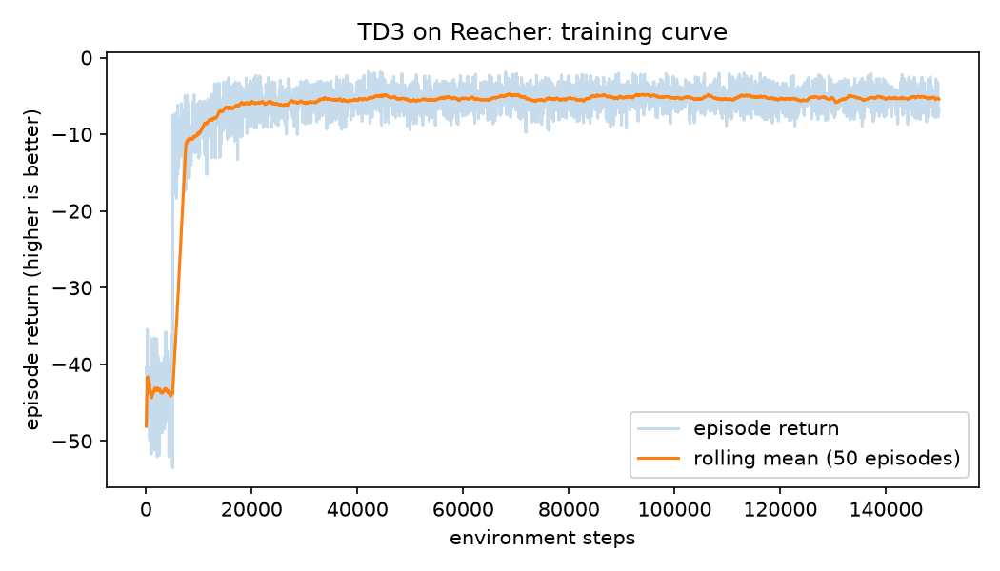
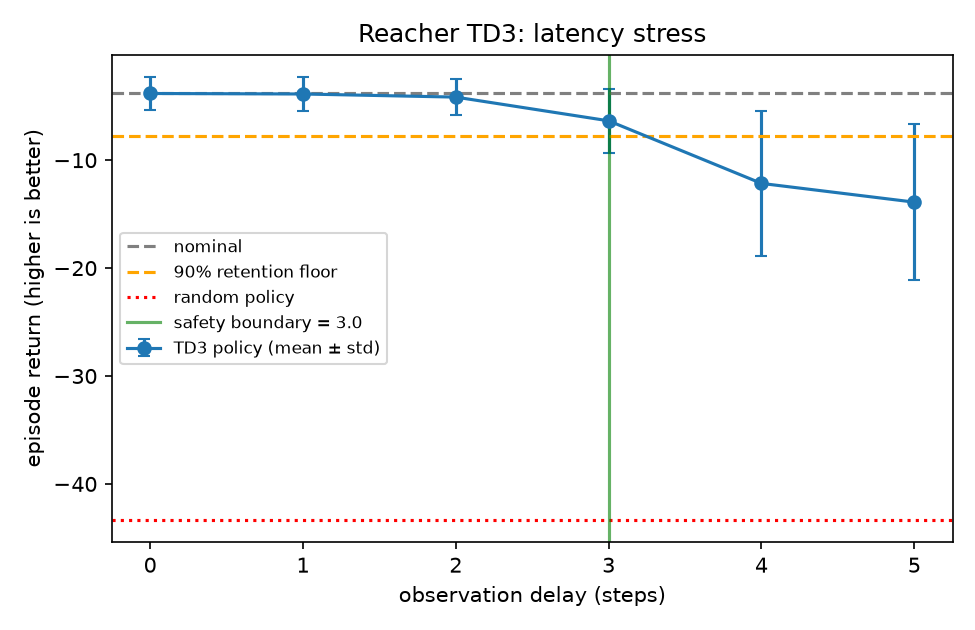
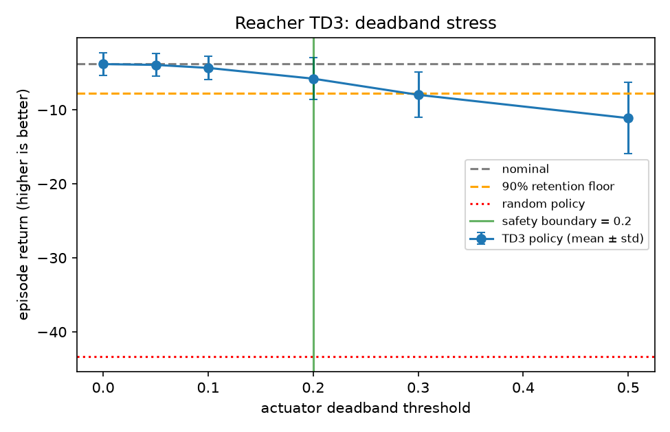
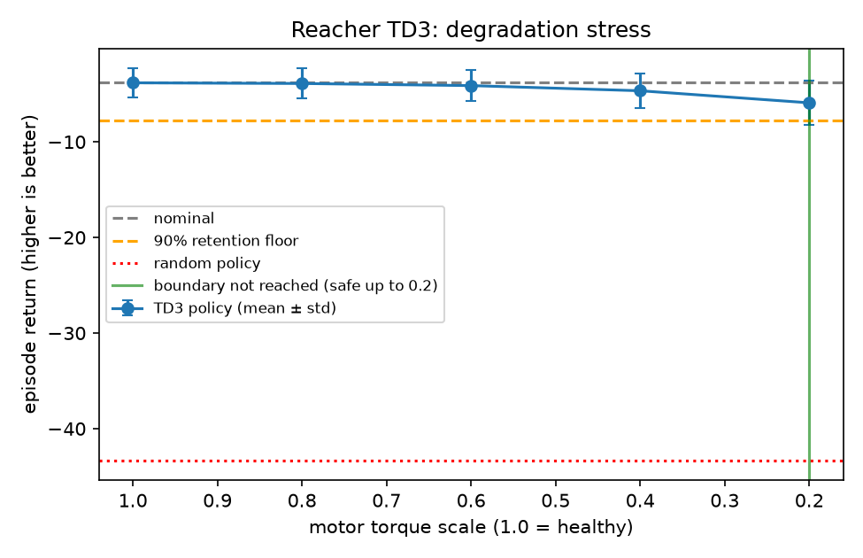

# Deep Feedback Control

A TD3 policy learns to drive a 2-joint MuJoCo arm (`Reacher`) to a random target, and an **IPQC-style stress-testing harness** then breaks it on purpose: delayed sensors, sticky actuators and worn motors. The result is a measured *safety boundary* for each failure mode, not just a reward curve.

Everything runs headless on one laptop GPU (RTX 3070 Ti, 8 GB). The work is available as scripts and as two Jupyter notebooks that call the same code.

## Results

Trained for 150k steps (about 37 minutes wall-clock on the RTX 3070 Ti). Deterministic evaluation over 60 episodes (3 seeds x 20) per condition:

| Policy | Mean episode return |
|---|---|
| Random actions | -43.35 |
| **Trained TD3, no stress** | **-3.82** (std 1.56) |



The training curve is noisier and lower than the evaluation score because training adds exploration noise to every action.

### Safety boundaries

Returns are negative, so each stress level gets a **retention score**: `(R - R_random) / (R_nominal - R_random)`. A score of 1.0 means as good as the healthy robot, 0.0 means no better than random. The **safety boundary** is the most severe level reached before the score first drops below 0.9.

| Failure mode | What it simulates | Safety boundary | Retention at the edge |
|---|---|---|---|
| Observation latency | slow or delayed sensors | **safe up to 3 steps**, fails at 4 | 0.936 at 3 steps, 0.789 at 4 |
| Actuator deadband | static friction: commands below a threshold do nothing | **safe up to 0.2**, fails at 0.3 | 0.950 at 0.2, 0.895 at 0.3 |
| Motor degradation | delivered torque is a fraction of the command | **not reached**: still safe at 20% torque | 0.947 at 0.2 |

What the measurements show:
- **Latency is the dangerous one.** Past 3 steps of delay, retention falls quickly (0.789 at 4 steps, 0.745 at 5) and the spread across episodes widens.
- **It is robust to weak motors.** Even at 20% torque the policy keeps 94.7% retention.
- **The playbook's 0.05 deadband is harmless** (0.997 retention). It takes a deadband of about 0.3 to cross the line.

Why is untested. Plausible hypotheses: the policy leans on joint-velocity information that goes stale under latency, and the reward's penalty on large actions means weaker motors cost less control effort. Checking either would need extra experiments (for example, measuring action magnitudes under degradation).

| Latency | Deadband | Degradation |
|---|---|---|
|  |  |  |

The full table is in [`plots/ipqc_results.csv`](plots/ipqc_results.csv).

## How it works

| Piece | File |
|---|---|
| Stress wrappers (`ObservationLatency`, `ActuatorDeadband`, `MotorDegradation`) and env factories | [`envs/stress_wrappers.py`](envs/stress_wrappers.py) |
| TD3 training, YAML config, optional Weights & Biases logging | [`scripts/train.py`](scripts/train.py), [`configs/td3_config.yaml`](configs/td3_config.yaml) |
| Stress sweep, retention scoring, safety boundaries, plots | [`scripts/evaluate_ipqc.py`](scripts/evaluate_ipqc.py) |
| Walkthrough: train and inspect | [`notebooks/01_train_td3.ipynb`](notebooks/01_train_td3.ipynb) |
| Walkthrough: stress test and boundaries | [`notebooks/02_ipqc_stress_test.ipynb`](notebooks/02_ipqc_stress_test.ipynb) |

The commanded action meets the deadband first (static friction acts on the command), then degradation scales the torque actually delivered. Latency returns the observation from *k* steps earlier, seeded with the first observation at the start of each episode.

Hyperparameters (learning rate 1e-3, batch 256, action-noise sigma 0.1, CUDA) and every sweep level live in the config file.

## Reproduce

Python 3.12.0 has a `zipfile` bug that stops Stable-Baselines3 reloading saved models, so use a newer Python (developed on 3.14).

```bash
python -m venv .venv
.venv/Scripts/python -m pip install torch --index-url https://download.pytorch.org/whl/cu128
.venv/Scripts/python -m pip install -r requirements.txt
.venv/Scripts/python -m ipykernel install --user --name ai_portfolio
```

Then either run the notebooks (kernel `ai_portfolio`), or the scripts:

```bash
python scripts/train.py                  # trains and writes models/reacher_td3.zip
python scripts/evaluate_ipqc.py          # writes plots/*.png and plots/ipqc_results.csv
python scripts/train.py --timesteps 1000 --learning-starts 100 --model-path models/dryrun   # GPU smoke test
pytest                                   # 33 tests
```

Set `DFC_QUICK=1` before launching a notebook for a tiny smoke-test run (outputs go to `plots/quick/`).

## Limitations

- Reacher is a simple benchmark. The stress curves demonstrate the method; they do not certify a real robot.
- One trained policy and one training seed: boundaries would shift for other seeds. Evaluation uses 3 seeds x 20 episodes per condition.
- `Reacher-v4` still works in Gymnasium 1.4 but is flagged out of date; the code falls back to `v5` automatically if v4 is removed.
- Weights & Biases logging is implemented and unit-tested with a stub, but has not been run against a live W&B account.
